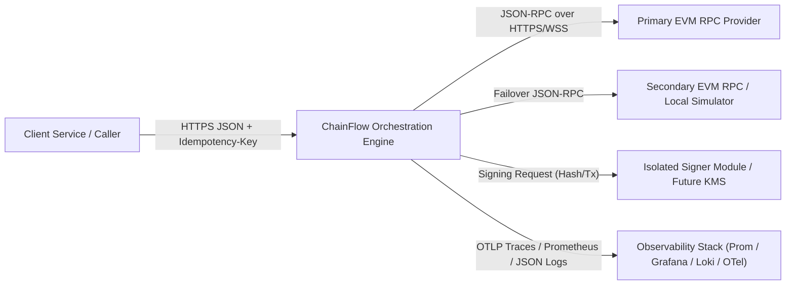
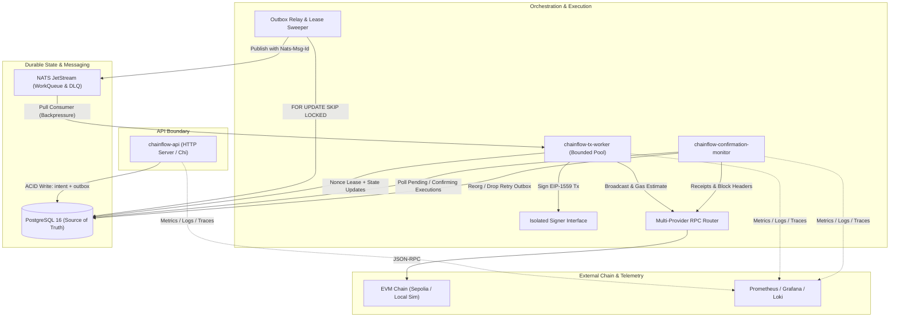
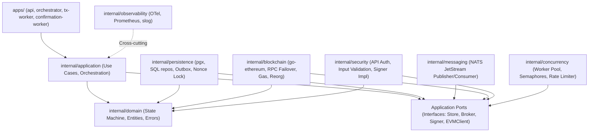

# 02 — System Architecture & Service Boundaries

## 1. System Context Diagram



## 2. Container Architecture Diagram



## 3. Component Architecture (Internal Package Boundaries)



**Dependency Rule:** `internal/domain` has zero external infrastructure dependencies (`pgx`, `nats`, `ethclient` are forbidden inside `domain`). Infrastructure adapters implement interfaces defined by `application`/`domain` boundaries.

## 4. Transaction Workflow & Sequence Diagrams

### 4.1 Happy-Path Submission, Outbox Dispatch, Execution & Confirmation

```mermaid
sequenceDiagram
    autonumber
    participant C as Caller
    participant A as API
    participant DB as PostgreSQL
    participant O as Outbox Relay
    participant N as NATS JetStream
    participant W as Tx Worker
    participant S as Signer
    participant R as EVM RPC

    C->>A: POST /v1/transactions (Idempotency-Key)
    A->>A: Validate payload, auth, chain_id
    A->>DB: BEGIN: INSERT intent(QUEUED) + outbox_event(tx.dispatch.v1)
    DB-->>A: COMMIT
    A-->>C: 202 Accepted (intent_id, status=QUEUED)

    O->>DB: SELECT outbox_event FOR UPDATE SKIP LOCKED
    O->>N: Publish tx.dispatch.v1 (Nats-Msg-Id = event.id)
    N-->>O: PubAck
    O->>DB: UPDATE outbox_event SET published_at = now()

    N->>W: Deliver tx.dispatch.v1 (Pull batch <= available slots)
    W->>DB: Acquire lease + transition QUEUED -> PROCESSING
    W->>R: Estimate gas & EIP-1559 fees
    W->>DB: Reserve next nonce for (chain_id, wallet)
    W->>S: Sign(chain_id, nonce, to, value, data, fees)
    S-->>W: SignedTx + deterministic tx_hash
    W->>DB: Persist tx_hash + transition PREPARED (before broadcast)
    W->>R: eth_sendRawTransaction(rawTx)
    R-->>W: tx_hash accepted
    W->>DB: Transition PREPARED -> BROADCASTED; release lease
    W->>N: Ack message

    loop Confirmation Monitor Tick / New Head
        Note over W,R: Monitor queries BROADCASTED/CONFIRMING executions
        ConfMon->>R: eth_getTransactionReceipt(tx_hash) & block header
        ConfMon->>DB: BROADCASTED -> CONFIRMING -> FINALIZED (and settle nonce)
    end
```

### 4.2 Ambiguous RPC Timeout Recovery Sequence

```mermaid
sequenceDiagram
    autonumber
    participant W as Tx Worker
    participant DB as PostgreSQL
    participant R1 as Primary RPC
    participant R2 as Secondary RPC

    W->>DB: Persist execution (nonce=42, tx_hash=0xabc, status=PREPARED)
    W->>R1: eth_sendRawTransaction(rawTx)
    R1--xW: ContextDeadlineExceeded (Timeout - unknown if mempool accepted)
    W->>DB: Record ambiguous broadcast error; keep status=PREPARED, lease expires or transitions RETRYING
    Note over W,R2: Do NOT allocate nonce 43!
    W->>R2: eth_getTransactionByHash(0xabc) / eth_getTransactionReceipt(0xabc)
    alt Found on-chain / in mempool
        R2-->>W: Tx present
        W->>DB: Transition PREPARED -> BROADCASTED (or CONFIRMING)
    else Not found on any healthy provider
        R2-->>W: ErrNotFound
        W->>R2: Re-broadcast identical signed rawTx (same nonce 42, same 0xabc)
    end
```

## 5. Failure Domains & Isolation

1. **API Ingress Domain:** Stateless HTTP servers; failure affects new submissions only. In-flight intents continue executing.
2. **Database Domain (PostgreSQL):** Single consistency bottleneck; protected by short transactions (never hold DB locks across RPC/network calls), strict pool limits, and statement timeouts.
3. **Broker Domain (NATS JetStream):** Transient outage stalls new dispatches without losing state because unpublished rows remain in `outbox_events` and active rows are recoverable via DB lease sweepers.
4. **Execution Worker Domain:** Crashes leave an expiring `lease_expires_at` on the execution/intent; the Lease Sweeper reclaims orphaned `PROCESSING`/`PREPARED` work and reconciles `tx_hash` before any re-sign.
5. **External RPC Domain:** Isolated behind circuit breakers, per-provider concurrency semaphores, and health-scored failover.

## 6. Repository Structure Analysis

```text
chainflow/
├── apps/                       # Role-scoped main packages (thin wiring only)
│   ├── api/                    # HTTP ingress & health/metrics endpoints
│   ├── orchestrator/           # Outbox publisher + stuck-lease/expiry sweeper
│   ├── tx-worker/              # JetStream consumer + bounded execution workers
│   └── confirmation-worker/    # Receipt polling, finality, drop & reorg detector
├── cmd/
│   └── chainflow-all/          # Combined local-dev runner (all modules in one process)
├── internal/
│   ├── domain/                 # Pure entities, explicit state machine, domain errors
│   ├── application/            # Use cases, command/query handlers, outbound ports
│   ├── persistence/            # pgx pool, SQL repositories, outbox, nonce locking
│   ├── messaging/              # NATS JetStream stream setup, publisher, pull consumer
│   ├── blockchain/             # go-ethereum adapter, RPC router, gas, receipt/reorg
│   ├── concurrency/            # Bounded worker pool, token bucket, singleflight helpers
│   ├── observability/          # slog logger, Prometheus collectors, OTel setup
│   ├── security/               # API key auth, input validator, isolated Signer impls
│   └── config/                 # Typed env-driven configuration & validation
├── contracts/                  # Minimal Solidity test contracts (Foundry) for E2E/reorg tests
├── migrations/                 # Numbered forward/rollback SQL migrations
├── deployments/
│   ├── docker/                 # Multi-stage non-root Dockerfiles
│   ├── compose/                # Docker Compose configs (Prometheus, Grafana, Loki)
│   └── kubernetes/             # Deferred until post-MVP local validation
├── docs/                       # Architecture, ADRs, Security, Specs, Runbooks
├── openspec/                   # OpenSpec specs & changes
├── tests/                      # integration/, e2e/, load/, chaos/
├── compose.yaml
├── go.mod
└── Makefile
```

**Design rationale:** Using one Go module (`go.mod` at root) avoids multi-module versioning friction while `internal/` enforces strict package boundaries. Compiling separate role binaries (`apps/*`) plus a `cmd/chainflow-all` entrypoint lets us deploy as a single binary locally or scale workers independently in Compose/Kubernetes without premature microservice RPC overhead.
