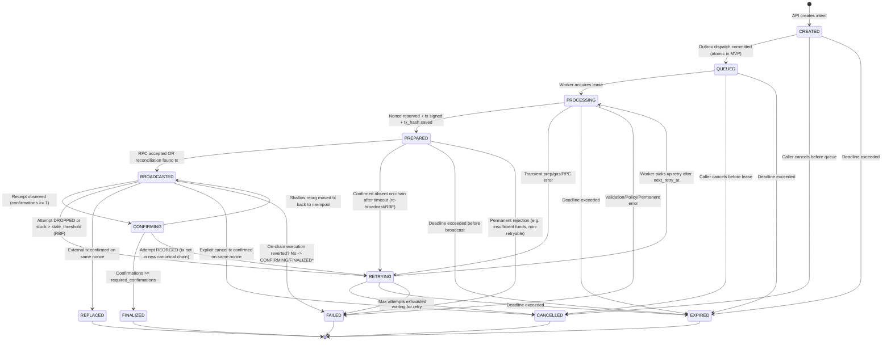

# 03 — Transaction Lifecycle & Explicit State Machine

## 1. Critical Evaluation of Preliminary States

Section 7 proposed 14 states:
`CREATED`, `QUEUED`, `PROCESSING`, `PREPARED`, `BROADCASTED`, `CONFIRMING`, `FINALIZED`, `RETRYING`, `FAILED`, `CANCELLED`, `EXPIRED`, `DROPPED`, `REPLACED`, `REORGED`.

### Architectural Defect in a Single Flat State Enum
If `DROPPED`, `REORGED`, and `REPLACED` live in the exact same flat column as `QUEUED` and `RETRYING` for a single transaction record, three ambiguities emerge:
1. **Retry vs Terminal Confusion:** When an attempted broadcast is `DROPPED` from the mempool or `REORGED` out of a fork, is the user's transaction intent finished, or should ChainFlow retry it? A dropped attempt is an outcome of *Attempt #1*, whereas the *Intent* transitions to `RETRYING` (and spawns *Attempt #2*) or `FAILED` if attempts/deadline are exhausted.
2. **Fee Bump (RBF) Ambiguity:** Replacing a stuck pending transaction with a higher-fee transaction using the same nonce supersedes the *first signed payload* (`tx_hash_1` -> `REPLACED`), while the *intent itself* remains live (`BROADCASTED` / `CONFIRMING`) under `tx_hash_2`. Conversely, if an external party consumes the nonce or an explicit cancel-tx wins on-chain, the *intent* becomes `REPLACED` (or `CANCELLED`).
3. **Auditability:** Overwriting `tx_hash` in-place destroys forensic evidence of which signed hashes were broadcast for a nonce.

### Resolution: Two-Level Coordinated State Model
1. **`IntentStatus` (Authoritative Business Lifecycle on `transaction_intents`):**
   - Active states: `CREATED`, `QUEUED`, `PROCESSING`, `PREPARED`, `BROADCASTED`, `CONFIRMING`, `RETRYING`
   - Terminal states: `FINALIZED`, `FAILED`, `CANCELLED`, `EXPIRED`, `REPLACED`
2. **`ExecutionStatus` (Per-Attempt On-Chain Lifecycle on `transaction_executions`):**
   - Active states: `ALLOCATING_NONCE`, `SIGNED`, `BROADCASTED`, `CONFIRMING`
   - Terminal attempt states: `CONFIRMED`, `DROPPED`, `REPLACED`, `REORGED`, `FAILED`

All 14 proposed states are preserved with zero ambiguity and mutually exclusive semantics.

## 2. Intent State Machine Diagram

*\*Note on On-Chain Revert:* A transaction that is mined and reverts (`receipt.status == 0`) **still consumed gas and a nonce on-chain and is final on the blockchain**. Therefore, its orchestration `IntentStatus` reaches `FINALIZED` with `execution_outcome = 'REVERTED'` (and `revert_reason` recorded), distinct from `execution_outcome = 'SUCCEEDED'`. Orchestration failure (`FAILED`) means ChainFlow could not land a finalized transaction on-chain.

## 3. State Definitions & Ownership

| State | Meaning | Single Owner | Mutable By |
| :--- | :--- | :--- | :--- |
| `CREATED` | Intent validated and persisted; not yet queued for execution. | API Ingress | API / Orchestrator |
| `QUEUED` | Dispatched to outbox/JetStream; waiting for an available worker. | API / Orchestrator | Tx Worker / API Cancel / Expiry Sweeper |
| `PROCESSING` | Worker holds active `lease_expires_at`; estimating gas and allocating nonce. | Assigned Tx Worker | Assigned Tx Worker / Lease Sweeper |
| `PREPARED` | Nonce reserved, transaction signed, `tx_hash` & `raw_tx` persisted; awaiting confirmed broadcast. | Assigned Tx Worker | Assigned Tx Worker / Lease Sweeper |
| `BROADCASTED` | Transaction accepted by at least one RPC mempool; awaiting inclusion. | Confirmation Monitor | Confirmation Monitor / RBF Retry Scheduler |
| `CONFIRMING` | Receipt mined in block `B` at `block_hash`; accumulating confirmations. | Confirmation Monitor | Confirmation Monitor |
| `RETRYING` | Waiting for `next_retry_at` after transient failure, mempool drop, or reorg. | Orchestrator / Tx Worker | Tx Worker / API Cancel / Expiry Sweeper |
| `FINALIZED` | **Terminal.** Confirmations >= `required_confirmations` (or chain `finalized` checkpoint). | Confirmation Monitor | None |
| `FAILED` | **Terminal.** Permanent error or `attempt_count >= max_attempts`. | Tx Worker / Orchestrator | None |
| `CANCELLED` | **Terminal.** Cancelled by caller before inclusion, or cancel-tx finalized. | API / Confirmation Monitor | None |
| `EXPIRED` | **Terminal.** `now() > expires_at` before broadcast/inclusion (with safe nonce cleanup). | Expiry Sweeper | None |
| `REPLACED` | **Terminal.** Superseded by an external tx or explicit replacement intent on that nonce. | Confirmation Monitor | None |

## 4. State Transition Table (Authoritative Rules)

| From | Event / Trigger | To | Owner | Precondition / Guard | Timeout / Recovery |
| :--- | :--- | :--- | :--- | :--- | :--- |
| `CREATED` | `Enqueue` | `QUEUED` | API (same DB tx) | Valid chain, wallet active | Outbox relays if unpublished |
| `QUEUED` | `AcquireLease` | `PROCESSING` | Tx Worker | `lease_expires_at IS NULL OR < now()` | Lease TTL = `30s`; Sweeper returns to `RETRYING` on crash |
| `QUEUED` | `CallerCancel` | `CANCELLED` | API | No active broadcast | Immediate terminal |
| `QUEUED` | `Expire` | `EXPIRED` | Expiry Sweeper | `now() > expires_at` | Immediate terminal |
| `PROCESSING` | `SignAndSave` | `PREPARED` | Tx Worker | Valid lease token, nonce reserved, `tx_hash` computed | Lease refreshed before signing |
| `PROCESSING` | `TransientError` | `RETRYING` | Tx Worker | `attempts < max_attempts` | Exponential backoff + jitter |
| `PROCESSING` | `PermanentError` | `FAILED` | Tx Worker | Non-retryable (invalid ABI/cap exceeded) | Route to DLQ + release unbroadcast nonce if safe |
| `PROCESSING` | `LeaseExpired` | `RETRYING` | Lease Sweeper | `lease_expires_at < now()` | Must check if nonce was reserved without `tx_hash` |
| `PREPARED` | `BroadcastAccepted` | `BROADCASTED` | Tx Worker | RPC returns hash or tx found via `GetTransaction` | Release worker lease; monitor takes over |
| `PREPARED` | `AmbiguousTimeout` | `RETRYING` | Tx Worker / Sweeper | Broadcast timed out; reconcile first | **Never allocate new nonce**; next retry re-checks `tx_hash` or re-sends identical `raw_tx` |
| `BROADCASTED` | `ReceiptFound` | `CONFIRMING` | Confirmation Monitor | `receipt.BlockNumber > 0` | Store `block_number`, `block_hash`, `gas_used`, `status` |
| `BROADCASTED` | `MempoolDropOrStale` | `RETRYING` | Confirmation Monitor | Not in mempool & `now() - broadcast_at > stale_ttl` | Spawns RBF execution with same nonce + >=12.5% bumped fees |
| `BROADCASTED` | `NonceConsumedByOther` | `REPLACED` | Confirmation Monitor | Chain nonce > reserved nonce & our `tx_hash` absent | Marks execution `REPLACED` |
| `CONFIRMING` | `ConfirmationsMet` | `FINALIZED` | Confirmation Monitor | `head - block_number + 1 >= required_confs` & `block_hash` matches | Settle nonce reservation |
| `CONFIRMING` | `BlockHashMismatch` | `RETRYING` | Confirmation Monitor | Canonical block at `block_number` != `execution.block_hash` | Mark attempt `REORGED`; check if `tx_hash` still in mempool/new block |

## 5. Stuck States, Replacement & Reorg Semantics

1. **Stuck in `PROCESSING` / `PREPARED` (Worker Crash):** Every transition into `PROCESSING` sets `lease_owner` and `lease_expires_at = now() + 30s` (with a fencing `version` increment). A background Lease Sweeper reclaims expired leases. If `tx_hash` already exists (`PREPARED`), recovery queries RPCs for `tx_hash` before retrying or rebroadcasting the exact signed payload.
2. **Stuck in `BROADCASTED` (Pending Too Long / Underpriced):** When `now() - broadcasted_at > rbf_threshold` (e.g., 2 minutes) and the tx is unmined, the Confirmation Monitor marks the intent `RETRYING` with `retry_reason = 'STALE_PENDING'`. The next execution reuses the **same nonce**, bumps `max_priority_fee_per_gas` and `max_fee_per_gas` by at least 15% (satisfying geth's 10% RBF rule) within `max_fee_per_gas_cap`, signs a new `Execution` row, and marks the prior execution `REPLACED` once mined or superseded.
3. **Chain Reorganization (`REORGED`):** While in `CONFIRMING`, the monitor verifies `eth_getBlockByNumber(execution.block_number)` matches `execution.block_hash`. On mismatch:
   - Mark current execution `REORGED` and record a `reorg_detected` event + metric.
   - Check `eth_getTransactionReceipt(tx_hash)` on the new canonical fork:
     - If re-included in a new block, create/update execution tracking the new `(block_number, block_hash)` in `CONFIRMING`.
     - If back in mempool, move back to `BROADCASTED`.
     - If evicted completely, transition intent to `RETRYING` to re-evaluate nonce and rebroadcast.
4. **Nonce Gap Prevention on Failure/Cancellation:** If an intent fails or is cancelled *after* reserving nonce `N` and *before* broadcast, that nonce `N` cannot be silently skipped if `N+1` was already allocated! Either (a) nonces are allocated sequentially and the unbroadcast gap `N` is filled by a zero-value self-transfer no-op transaction (or reassigned to the next queued intent for that wallet), or (b) strict per-wallet in-flight window = 1 in MVP Phase 1, expanding to pipelined window > 1 with gap-filler support. (See `06-concurrency-nonce-and-failures.md` and ADR-0006.)
