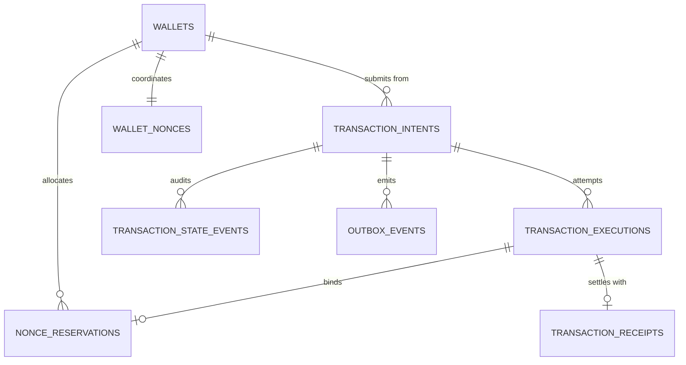

# 04 — Domain Model & PostgreSQL Data Design

## 1. Domain Entities & Ownership Analysis

| Entity | Role & Responsibility | Persisted Aggregate? | Notes |
| :--- | :--- | :--- | :--- |
| **`TransactionIntent`** | Immutable user request + authoritative lifecycle state (`IntentStatus`), idempotency key, deadline, and active execution pointer. | Yes (`transaction_intents`) | Core aggregate root. Payload fields (`chain_id`, `from_address`, `to_address`, `value_wei`, `calldata`) are immutable after creation. |
| **`TransactionExecution`** | Represents one concrete attempt to land an intent on-chain with an allocated `nonce`, EIP-1559 fee bounds, `tx_hash`, raw signed tx (or hash/encoding policy), and `ExecutionStatus`. | Yes (`transaction_executions`) | 1-to-many from `TransactionIntent` to preserve forensic history across RBF bumps, drops, and reorgs. |
| **`Wallet`** | Managed sender identity (`chain_id`, `address`, `signer_key_ref`, `status`, `max_inflight_nonces`). | Yes (`wallets`) | Never stores private keys; `signer_key_ref` is an opaque identifier for the isolated `Signer`. |
| **`WalletNonceState` & `NonceReservation`** | Durable coordinator for `next_nonce` per `(chain_id, wallet_address)` and per-nonce reservation leases (`RESERVED`, `BROADCASTED`, `CONFIRMED`, `RELEASED`). | Yes (`wallet_nonces`, `nonce_reservations`) | Prevents duplicate nonce allocation across distributed worker replicas. |
| **`TransactionReceipt`** | Verified on-chain inclusion data (`block_number`, `block_hash`, `tx_index`, `gas_used`, `effective_gas_price`, `onchain_status`, `logs_bloom`/summary). | Yes (`transaction_receipts`) | Linked 1-to-1 to `transaction_executions`; invalidated/flagged on reorg. |
| **`OutboxEvent`** | Transactional outbox record committed alongside state changes for reliable NATS JetStream publication. | Yes (`outbox_events`) | Uses `bigint generated always as identity` for sequential clustering and minimal index bloat. |
| **`TransactionStateEvent`** | Append-only audit log of every `IntentStatus` / `ExecutionStatus` transition, actor, and reason. | Yes (`transaction_state_events`) | Enables deterministic timeline reconstruction and debugging. |
| **`BlockchainNetwork`** | Chain configuration (`chain_id`, `name`, `required_confirmations`, `block_time_ms`, `max_fee_per_gas_cap_wei`). | Config / Reference table | Loaded from config or `blockchain_networks` table; MVP supports Sepolia (`11155111`) + Local Sim (`31337`). |
| **`RPCProvider`** | Endpoint config, priority weight, rate-limit budget, and runtime health circuit state. | Config + In-Memory Health | Runtime health/circuit state is ephemeral per worker/monitor; static config lives in config/DB. |
| **`RetryPolicy`** | Value object embedded/referenced by intent or chain config (`max_attempts`, `base_delay`, `max_delay`, `rbf_bump_bps`). | Value Object | Stored as explicit columns/defaults on intent or policy config, avoiding an unnecessary workflow-engine table. |
| **`Workflow` / `Job`** | Evaluated and **folded into** `TransactionIntent` + `OutboxEvent` + lease columns on `transaction_intents`. | Folded (No extra tables) | Avoids dual-state drift between a generic "jobs" table and `transaction_intents`. |

## 2. Entity Relationship Diagram



## 3. PostgreSQL Schema Design (DDL)

Designed per PostgreSQL best practices (`bigint generated always as identity` for append logs/outbox, app-generated time-ordered `uuid` [UUIDv7] for externally exposed aggregate IDs, `timestamptz`, `numeric(78,0)` for `uint256` wei amounts, `text` with `CHECK` constraints, and partial indexes for active rows).

```sql
-- 1. Managed Wallets (no private keys stored here)
CREATE TABLE wallets (
    id                  uuid PRIMARY KEY, -- App-generated UUIDv7
    chain_id            bigint NOT NULL CHECK (chain_id > 0),
    address             bytea NOT NULL CHECK (octet_length(address) = 20),
    label               text NOT NULL,
    signer_key_ref      text NOT NULL, -- Opaque KMS / Signer key reference
    status              text NOT NULL CHECK (status IN ('ACTIVE', 'PAUSED', 'RETIRED')),
    max_inflight_nonces integer NOT NULL DEFAULT 1 CHECK (max_inflight_nonces BETWEEN 1 AND 64),
    created_at          timestamptz NOT NULL DEFAULT now(),
    updated_at          timestamptz NOT NULL DEFAULT now(),
    UNIQUE (chain_id, address)
);

-- 2. Per-Wallet Nonce High-Water Mark
CREATE TABLE wallet_nonces (
    chain_id            bigint NOT NULL,
    wallet_address      bytea NOT NULL CHECK (octet_length(wallet_address) = 20),
    next_nonce          bigint NOT NULL CHECK (next_nonce >= 0),
    last_synced_nonce   bigint NOT NULL DEFAULT 0 CHECK (last_synced_nonce >= 0),
    last_synced_at      timestamptz,
    updated_at          timestamptz NOT NULL DEFAULT now(),
    PRIMARY KEY (chain_id, wallet_address),
    FOREIGN KEY (chain_id, wallet_address) REFERENCES wallets (chain_id, address)
);

-- 3. Authoritative Transaction Intents
CREATE TABLE transaction_intents (
    id                      uuid PRIMARY KEY, -- App-generated UUIDv7
    tenant_id               text NOT NULL,
    idempotency_key         text NOT NULL,
    request_hash            bytea NOT NULL CHECK (octet_length(request_hash) = 32), -- SHA-256 of canonical payload

    chain_id                bigint NOT NULL CHECK (chain_id > 0),
    from_address            bytea NOT NULL CHECK (octet_length(from_address) = 20),
    to_address              bytea CHECK (to_address IS NULL OR octet_length(to_address) = 20),
    value_wei               numeric(78, 0) NOT NULL CHECK (value_wei >= 0),
    calldata                bytea NOT NULL DEFAULT '\x'::bytea,
    gas_limit_override      bigint CHECK (gas_limit_override IS NULL OR gas_limit_override >= 21000),
    max_fee_cap_wei         numeric(78, 0) NOT NULL CHECK (max_fee_cap_wei > 0),
    priority                smallint NOT NULL DEFAULT 0 CHECK (priority BETWEEN -10 AND 10),

    status                  text NOT NULL CHECK (status IN (
                                'CREATED', 'QUEUED', 'PROCESSING', 'PREPARED',
                                'BROADCASTED', 'CONFIRMING', 'RETRYING',
                                'FINALIZED', 'FAILED', 'CANCELLED', 'EXPIRED', 'REPLACED'
                            )),
    execution_outcome       text CHECK (execution_outcome IN ('SUCCEEDED', 'REVERTED')),
    active_execution_id     uuid,
    attempt_count           integer NOT NULL DEFAULT 0 CHECK (attempt_count >= 0),
    max_attempts            integer NOT NULL DEFAULT 5 CHECK (max_attempts > 0),
    next_retry_at           timestamptz,
    expires_at              timestamptz NOT NULL,

    -- Distributed Lease & Optimistic Concurrency
    version                 bigint NOT NULL DEFAULT 1,
    lease_owner             text,
    lease_expires_at        timestamptz,
    last_error_code         text,
    last_error_message      text,
    trace_id                text,

    created_at              timestamptz NOT NULL DEFAULT now(),
    updated_at              timestamptz NOT NULL DEFAULT now(),
    finalized_at            timestamptz,

    UNIQUE (tenant_id, idempotency_key),
    FOREIGN KEY (chain_id, from_address) REFERENCES wallets (chain_id, address)
);

-- 4. Execution Attempts (1-to-many per Intent; preserves RBF & Reorg history)
CREATE TABLE transaction_executions (
    id                      uuid PRIMARY KEY, -- App-generated UUIDv7
    intent_id               uuid NOT NULL REFERENCES transaction_intents (id),
    attempt_number          integer NOT NULL CHECK (attempt_number > 0),
    chain_id                bigint NOT NULL,
    from_address            bytea NOT NULL CHECK (octet_length(from_address) = 20),
    nonce                   bigint NOT NULL CHECK (nonce >= 0),
    gas_limit               bigint NOT NULL CHECK (gas_limit >= 21000),
    max_priority_fee_wei    numeric(78, 0) NOT NULL CHECK (max_priority_fee_wei >= 0),
    max_fee_per_gas_wei     numeric(78, 0) NOT NULL CHECK (max_fee_per_gas_wei > 0),
    tx_hash                 bytea CHECK (tx_hash IS NULL OR octet_length(tx_hash) = 32),
    -- Raw signed tx stored temporarily for safe idempotent re-broadcast only; purged after finality
    raw_signed_tx           bytea,
    status                  text NOT NULL CHECK (status IN (
                                'ALLOCATING_NONCE', 'SIGNED', 'BROADCASTED',
                                'CONFIRMING', 'CONFIRMED', 'DROPPED', 'REPLACED', 'REORGED', 'FAILED'
                            )),
    rpc_provider_used       text,
    broadcasted_at          timestamptz,
    error_code              text,
    error_message           text,
    created_at              timestamptz NOT NULL DEFAULT now(),
    updated_at              timestamptz NOT NULL DEFAULT now(),
    UNIQUE (intent_id, attempt_number)
);

-- 5. Nonce Reservations (prevents duplicate active nonces across replicas)
CREATE TABLE nonce_reservations (
    id                  bigint GENERATED ALWAYS AS IDENTITY PRIMARY KEY,
    chain_id            bigint NOT NULL,
    wallet_address      bytea NOT NULL CHECK (octet_length(wallet_address) = 20),
    nonce               bigint NOT NULL CHECK (nonce >= 0),
    intent_id           uuid NOT NULL REFERENCES transaction_intents (id),
    status              text NOT NULL CHECK (status IN ('RESERVED', 'CONFIRMED', 'RELEASED', 'CONSUMED_EXTERNAL')),
    reserved_at         timestamptz NOT NULL DEFAULT now(),
    updated_at          timestamptz NOT NULL DEFAULT now()
);

-- Only ONE active reservation may hold a given (chain_id, wallet_address, nonce)
CREATE UNIQUE INDEX uidx_nonce_reservations_active
    ON nonce_reservations (chain_id, wallet_address, nonce)
    WHERE status = 'RESERVED';

-- 6. On-Chain Transaction Receipts
CREATE TABLE transaction_receipts (
    execution_id            uuid PRIMARY KEY REFERENCES transaction_executions (id),
    tx_hash                 bytea NOT NULL CHECK (octet_length(tx_hash) = 32),
    block_number            bigint NOT NULL CHECK (block_number >= 0),
    block_hash              bytea NOT NULL CHECK (octet_length(block_hash) = 32),
    transaction_index       integer NOT NULL CHECK (transaction_index >= 0),
    gas_used                bigint NOT NULL CHECK (gas_used >= 0),
    effective_gas_price_wei numeric(78, 0) NOT NULL CHECK (effective_gas_price_wei >= 0),
    onchain_status          smallint NOT NULL CHECK (onchain_status IN (0, 1)),
    confirmations           integer NOT NULL DEFAULT 1 CHECK (confirmations >= 0),
    reorged                 boolean NOT NULL DEFAULT false,
    observed_at             timestamptz NOT NULL DEFAULT now(),
    updated_at              timestamptz NOT NULL DEFAULT now()
);

-- 7. Transactional Outbox
CREATE TABLE outbox_events (
    id                  bigint GENERATED ALWAYS AS IDENTITY PRIMARY KEY,
    event_id            uuid NOT NULL UNIQUE, -- Used as Nats-Msg-Id for JetStream deduplication
    aggregate_type      text NOT NULL,
    aggregate_id        uuid NOT NULL,
    subject             text NOT NULL,
    event_version       smallint NOT NULL DEFAULT 1,
    payload             jsonb NOT NULL,
    trace_parent        text,
    created_at          timestamptz NOT NULL DEFAULT now(),
    available_at        timestamptz NOT NULL DEFAULT now(),
    locked_until        timestamptz,
    published_at        timestamptz,
    publish_attempts    integer NOT NULL DEFAULT 0,
    last_error          text
);

-- 8. Append-Only State Transition Audit Log
CREATE TABLE transaction_state_events (
    id                  bigint GENERATED ALWAYS AS IDENTITY PRIMARY KEY,
    intent_id           uuid NOT NULL REFERENCES transaction_intents (id),
    execution_id        uuid,
    from_status         text,
    to_status           text NOT NULL,
    actor               text NOT NULL,
    reason              text,
    metadata            jsonb,
    created_at          timestamptz NOT NULL DEFAULT now()
);
```

## 4. Index Strategy

Using **partial indexes** so completed/terminal millions of rows never bloat hot operational scans:

```sql
-- Outbox Relay polling (only unpublished rows)
CREATE INDEX idx_outbox_unpublished
    ON outbox_events (available_at, id)
    WHERE published_at IS NULL;

-- Confirmation Monitor active scan (only pending/confirming executions)
CREATE INDEX idx_executions_active_monitor
    ON transaction_executions (chain_id, broadcasted_at)
    WHERE status IN ('BROADCASTED', 'CONFIRMING');

-- Unique lookup by tx_hash when present
CREATE UNIQUE INDEX uidx_executions_tx_hash
    ON transaction_executions (chain_id, tx_hash)
    WHERE tx_hash IS NOT NULL;

-- Lease Sweeper & Retry Scheduler (only non-terminal intents)
CREATE INDEX idx_intents_active_leases
    ON transaction_intents (lease_expires_at)
    WHERE status IN ('PROCESSING', 'PREPARED') AND lease_expires_at IS NOT NULL;

CREATE INDEX idx_intents_retrying
    ON transaction_intents (next_retry_at)
    WHERE status = 'RETRYING';

CREATE INDEX idx_intents_expirable
    ON transaction_intents (expires_at)
    WHERE status IN ('CREATED', 'QUEUED', 'PROCESSING', 'PREPARED', 'RETRYING');

-- Foreign key & query lookups
CREATE INDEX idx_executions_intent_id ON transaction_executions (intent_id);
CREATE INDEX idx_state_events_intent_id ON transaction_state_events (intent_id, id);
CREATE INDEX idx_intents_wallet_status ON transaction_intents (chain_id, from_address, status)
    WHERE status NOT IN ('FINALIZED', 'FAILED', 'CANCELLED', 'EXPIRED', 'REPLACED');
```

## 5. Transaction Boundaries & Concurrency Control Rules

1. **Short-Transaction Rule (Mandatory):** Never hold a PostgreSQL transaction or `FOR UPDATE` row lock across any NATS publish, Signer call, or EVM RPC network call. Every DB transaction executes pure SQL in `<10 ms` with `statement_timeout = '5s'`.
2. **Optimistic Locking on Intent Transitions:** All state updates execute:
   `UPDATE transaction_intents SET status = $new, version = version + 1, updated_at = now() WHERE id = $id AND status = $expected AND version = $expected_version`.
   If `rows_affected == 0`, another worker or sweeper won the race; abort cleanly.
3. **Outbox Relay Pattern:** `SELECT id, event_id, subject, payload, trace_parent FROM outbox_events WHERE published_at IS NULL AND available_at <= now() ORDER BY id LIMIT 100 FOR UPDATE SKIP LOCKED` claims a batch, OR better: claim via an `UPDATE ... locked_until` pattern so the DB transaction commits *before* NATS `Publish`, then a fast `UPDATE outbox_events SET published_at = now() WHERE id = ANY($1)` marks completion after NATS `PubAck`. (Avoids holding DB locks during NATS network I/O!)
4. **Retention & Cleanup Policies:**
   - `raw_signed_tx` on `transaction_executions`: set to `NULL` once `IntentStatus` reaches a terminal state (`FINALIZED`, `CANCELLED`, `REPLACED`, `FAILED`, `EXPIRED`).
   - `outbox_events`: purge published rows older than 7 days in batched deletes (`DELETE ... WHERE id IN (SELECT ... LIMIT 5000)`).
   - `transaction_intents` / `transaction_state_events`: retain 90+ days online (partition by `created_at` monthly if volume exceeds 10M rows).
