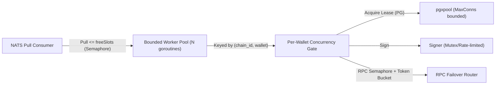

# 06 — Concurrency Engine, Nonce Coordination & Failure Matrix

## 1. Bounded Concurrency Architecture (Go)

Every concurrent unit in ChainFlow has explicit capacity limits, context cancellation, and measurable saturation signals:

### Key Concurrency Controls & Why Each Exists

1. **Pull-Based Backpressure (Not Push):** Workers pull from NATS JetStream *only* up to `availableSlots = maxWorkers - activeWorkers`. If all `100` workers are busy, unpulled messages stay safely buffered in JetStream instead of piling up in Go heap memory or timing out their `AckWait`.
2. **Fixed Worker Pool + `errgroup`:** `N` worker goroutines (e.g., default `20`, load-test target `100`) consume from a bounded job channel (`cap = N`) fed by the pull loop. Zero per-request `go func()` spawning.
3. **Database Connection Pool Sizing:** `pgxpool` `MaxConns` must be explicitly sized (e.g., `25-50` per replica, kept strictly below Postgres `max_connections`) and **never** held while waiting on RPCs or sleep timers.
4. **Per-RPC Provider Semaphore & Token Bucket:** Each `RPCProvider` has an independent concurrency semaphore (e.g., `max_inflight = 20`) and token-bucket rate limiter so one slow or rate-limited provider cannot exhaust all workers.
5. **Singleflight for Shared Chain Head / Gas Queries:** Confirmation monitor and workers coalesce concurrent `eth_blockNumber` and EIP-1559 `eth_feeHistory` lookups using `golang.org/x/sync/singleflight` (with short TTL cache e.g. 1-2s) to cut redundant RPC load by 10-50x during bursts.
6. **Lease Heartbeat & Fencing:** While a worker processes a job, a lightweight ticker extends `lease_expires_at` only if `ctx.Err() == nil` and `version` matches; if extension fails (`0 rows`), the worker aborts immediately (`ctx` cancel) to prevent split-brain execution.
7. **Graceful Shutdown Order:**
   1. Stop HTTP listener (`server.Shutdown(shutdownCtx)`) / stop pulling new NATS messages.
   2. Cancel intake loop context; close internal job channel.
   3. Wait for active workers to finish current atomic step (or hit `shutdownTimeout`, e.g., `25s`, releasing/nak'ing unfinished NATS msgs cleanly).
   4. Flush OTel traces/metrics, close NATS connection, close `pgxpool`.

---

## 2. Distributed Nonce Management Strategy

In-memory `sync.Mutex` fails as soon as 2+ worker replicas run or a worker crashes mid-flight. ChainFlow uses **PostgreSQL-coordinated nonce allocation + on-chain reconciliation**:

### 2.1 Allocation Protocol
1. Before reserving a nonce, estimate gas and validate fee caps against the RPC router (outside any DB transaction).
2. Execute a short (`<5 ms`) serializable/row-locked DB transaction:
   - `SELECT next_nonce FROM wallet_nonces WHERE chain_id = $1 AND wallet_address = $2 FOR UPDATE`
   - Check active `COUNT(*) FROM nonce_reservations WHERE chain_id = $1 AND wallet_address = $2 AND status = 'RESERVED'`.
   - Enforce `active_count < wallet.max_inflight_nonces` (MVP default: `1` for zero-gap strict ordering; configurable up to `16` for pipelined throughput). If at capacity, return `ErrWalletInflightLimit` and `NakWithDelay` the NATS message with short jitter (backpressure at wallet granularity).
   - Otherwise, assign `N = next_nonce`, `INSERT INTO nonce_reservations (..., nonce = N, status = 'RESERVED')`, `UPDATE wallet_nonces SET next_nonce = N + 1`, and create `transaction_executions` row (`ALLOCATING_NONCE`). Commit.
3. **Sign & Persist Before Broadcast:** Call `Signer.Sign(...)`, compute deterministic `tx_hash`, then `UPDATE transaction_executions SET tx_hash = $1, raw_signed_tx = $2, status = 'SIGNED'` and `transaction_intents SET status = 'PREPARED', active_execution_id = $exec_id`. Commit *before* calling `eth_sendRawTransaction`.

### 2.2 Reconciliation & Recovery
- **Worker crash before broadcast (`PREPARED`):** Lease Sweeper inspects `tx_hash` via RPC. If not in mempool, re-broadcasts the exact `raw_signed_tx` (same nonce `N`). If `expires_at` passed and never broadcast, either re-assign `N` or submit a zero-value self-transfer cancel tx at nonce `N` if `next_nonce > N + 1` (preventing permanent nonce gap!).
- **Nonce-too-low error on broadcast:** Trigger `ReconcileWalletNonce`: fetch `eth_getTransactionCount(wallet, "pending")` and `("latest")`. Advance `wallet_nonces.next_nonce = GREATEST(next_nonce, pending_nonce)`, mark stale reservations `CONSUMED_EXTERNAL` if confirmed externally, and retry intent with fresh nonce.
- **RBF Replacement:** Reuses the **exact** nonce `N` from the existing `nonce_reservations` row—never increments `wallet_nonces.next_nonce`.

---

## 3. Comprehensive Failure Handling Matrix (16 Scenarios)

| # | Scenario | Consistency Risk | Recovery Behavior | Key Metrics | Reproduction Test Design |
| :--- | :--- | :--- | :--- | :--- | :--- |
| **1** | **API crashes after DB commit, before returning HTTP 202** | Client retries with same `Idempotency-Key`; risk of duplicate intent or lost intent. | Intent + outbox row are already committed. Client retry hits `UNIQUE(tenant_id, idempotency_key)` and receives existing `intent_id`. Outbox still dispatches. | `chainflow_api_idempotency_hits_total` | Integration test: commit TX, simulate handler panic/abort before response, replay identical `POST` and assert single DB row + same `intent_id`. |
| **2** | **Outbox publisher crashes after NATS PubAck, before DB `published_at` update** | Same event published twice to NATS on restart. | JetStream deduplicates within `DedupWindow` via `Nats-Msg-Id = event_id`; even past window, worker DB lease check rejects duplicate processing. | `chainflow_outbox_publish_retries_total`, `chainflow_worker_duplicate_deliveries_total` | Fault injection: inject crash hook between `js.Publish` and `MarkPublished`, restart outbox, assert single execution created. |
| **3** | **Worker crashes after receiving job (in `PROCESSING`)** | Intent stuck in `PROCESSING` forever; NATS msg unacked. | `lease_expires_at` expires (`30s`); NATS `AckWait` expires (`45s`). Lease Sweeper transitions intent to `RETRYING` (or `tx-worker` acquires expired lease). | `chainflow_leases_expired_total` | Concurrency/chaos test: kill worker goroutine context mid-`PROCESSING`, advance clock/wait lease TTL, verify sweeper recovers and completes intent. |
| **4** | **Worker crashes after signing, before saving `tx_hash` (`ALLOCATING_NONCE`)** | Nonce `N` was reserved in `wallet_nonces`, `tx_hash` never saved, raw tx never broadcast. | Sweeper sees `PROCESSING` expired with `tx_hash IS NULL` and `attempt` in `ALLOCATING_NONCE`. Marks attempt `FAILED`, transitions intent to `RETRYING` reusing reserved nonce `N` (since never broadcast!). | `chainflow_nonce_reclaimed_total` | Integration test: reserve nonce `N`, abort before `SaveSigned`, run sweeper + retry, assert nonce `N` is reused (no gap!) and finalized. |
| **5** | **Worker crashes after broadcast, before saving `BROADCASTED` status** | Tx is live on-chain (`PREPARED` in DB), risk of re-signing a second nonce. | Because `tx_hash` and `raw_signed_tx` were persisted in `PREPARED` **before** broadcast, sweeper checks `GetTransactionByHash(tx_hash)` on RPC, sees it in mempool/mined, and advances `PREPARED -> BROADCASTED/CONFIRMING`. | `chainflow_reconciled_prepared_tx_total` | Fault injection: mock RPC records broadcast then panics worker before DB update; verify sweeper reconciles `tx_hash` without allocating nonce `N+1`. |
| **6** | **RPC returns timeout after broadcast may have succeeded** | Ambiguous state; re-allocating a new nonce causes double-spend/double execution. | Keep `PREPARED`, transition to `RETRYING` (`RPC_TIMEOUT_RECONCILE`). Next step queries `GetTransactionByHash(tx_hash)` across providers; if absent, re-broadcasts identical `raw_signed_tx`. | `chainflow_rpc_ambiguous_timeouts_total` | Fault test: mock RPC accepts tx into simulator then returns `context.DeadlineExceeded`; verify single on-chain tx & zero duplicate nonces. |
| **7** | **Primary RPC provider becomes unavailable** | Broadcasts and receipt checks stall or fail. | Circuit breaker opens on consecutive 5xx/timeouts; RPC Router routes to Secondary healthy provider. All workers resume seamlessly. | `chainflow_rpc_provider_up`, `chainflow_rpc_failovers_total` | Integration test: kill/503 primary mock RPC, assert automatic failover to secondary RPC within 1 retry cycle. |
| **8** | **RPC provider returns inconsistent data (lagging head or conflicting receipt)** | False reorg alarm or premature `FAILED` state. | Cross-verify suspicious missing receipt/block-hash mismatch against a second healthy provider (or wait 1-2 poll intervals) before declaring `REORGED` or `DROPPED`. | `chainflow_rpc_inconsistency_detected_total` | Fault test: Provider A lags 5 blocks behind Provider B; assert monitor does not falsely mark tx `DROPPED`. |
| **9** | **Message delivered more than once by NATS** | Two workers attempt to execute the same intent concurrently. | Atomic `UPDATE ... WHERE status IN ('QUEUED','RETRYING') AND version = $v` allows strictly one winner; loser gets 0 rows and `Ack()`s cleanly. | `chainflow_worker_duplicate_deliveries_total` | Concurrency test (`-race`): dispatch same `intent_id` concurrently to 20 workers; assert 1 execution & 1 nonce reserved. |
| **10** | **PostgreSQL becomes temporarily unavailable** | API returns `503`; workers cannot commit state or extend leases. | `readyz` marks unhealthy; workers pause NATS pulls (circuit breaker) and `NakWithDelay`; in-flight workers abort before RPC broadcast if lease check fails. | `chainflow_db_errors_total` | Fault test: pause Postgres/inject pool error mid-run, restore DB, verify zero data corruption and full recovery. |
| **11** | **NATS restarts / loses ephemeral connection** | Outbox cannot publish; workers disconnect. | `outbox_events` stays unpublished in PG; Outbox Relay retries with exponential backoff; NATS File storage recovers streams; workers auto-reconnect. | `chainflow_nats_reconnects_total`, `chainflow_outbox_backlog` | Compose/chaos test: restart NATS container while submitting 500 intents; verify 100% eventual delivery. |
| **12** | **Container terminated (`SIGTERM`) during execution** | Mid-flight RPC or DB write interrupted. | Graceful shutdown stops intake, waits up to `25s` for active steps to checkpoint DB, `Nak`s unstarted jobs. Any abrupt `SIGKILL` falls back to Scenario 3/4/5 lease recovery. | `chainflow_graceful_shutdown_duration_seconds` | Integration test: send `SIGTERM` under active load; verify clean drain and zero orphaned intents after restart. |
| **13** | **Blockchain transaction remains pending too long** | Head-of-line blocking for wallet; intent misses SLA. | Confirmation Monitor detects `age > rbf_threshold`, sets `RETRYING (STALE_RBF)`. Worker creates new `Execution` with same nonce `N` and >=15% higher fees within `max_fee_cap_wei`. | `chainflow_tx_rbf_replacements_total` | Simulator test: freeze mining or set low base fee, trigger RBF threshold, verify bumped tx mines and prior execution marked `REPLACED`. |
| **14** | **Transaction is replaced (by RBF or external wallet)** | Monitor waits forever for old `tx_hash` receipt. | Monitor checks all executions for that intent (or checks wallet chain nonce > `N`). When replacement `tx_hash_2` confirms, `tx_hash_1` is marked `REPLACED`; if external tx took nonce `N`, intent moves to `REPLACED`. | `chainflow_tx_external_replacements_total` | Simulator test: submit external tx with same nonce `N` directly to Anvil; verify ChainFlow detects nonce consumption and transitions intent to `REPLACED`. |
| **15** | **Blockchain experiences a chain reorganization** | Transaction confirmed at block `B` (`hash1`) disappears or moves to block `B+1` (`hash2`). | Monitor compares canonical `block_hash` at `receipt.block_number` on every poll until finality. Mismatch marks execution `REORGED`, re-queries receipt, and either re-tracks new block or moves intent to `RETRYING`. | `chainflow_chain_reorgs_total` | E2E test with Anvil (`anvil_reorg`): mine tx in block `B`, reorg `B` out, verify ChainFlow detects mismatch, moves out of `CONFIRMING`, and re-lands transaction. |
| **16** | **Confirmation monitor misses blocks or restarts** | Transactions stay stuck in `BROADCASTED`/`CONFIRMING` despite being mined. | Monitor is **stateless/DB-driven**: on every tick it queries all `BROADCASTED`/`CONFIRMING` rows in PG and checks current `blockNumber` + `GetTransactionReceipt`, never relying solely on ephemeral WebSocket subscriptions. | `chainflow_monitor_lag_blocks`, `chainflow_confirmation_latency_seconds` | Integration test: stop monitor, mine 10 blocks on simulator, restart monitor, verify all intents reconcile to `FINALIZED`. |
